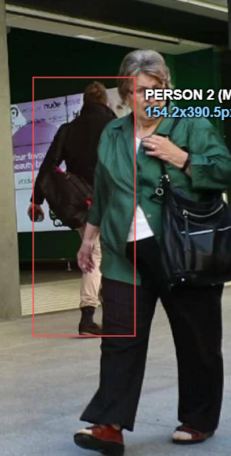
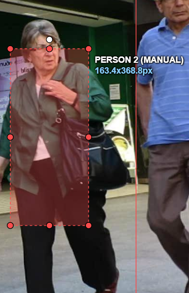
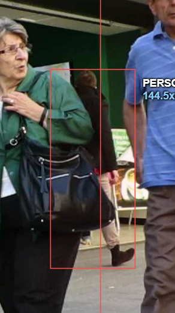

# Báo cáo cá nhân — 2A202603046_VuVanDang

Đoạn video: MOT17-09, 150 frame (frame 1–150), nguồn MOTChallenge, giấy phép CC BY-NC-SA 3.0.

## 0. Thông tin học viên

- Họ tên: Vũ Văn Đăng
- MSSV: 2A202603046
- Mã đề (A/B/C): C
- Email: dang.vv202603046@sis.hust.edu.vn
- Link repository: https://github.com/vuvandang/K5-L2-DAY05-VuVanDang-2A202603046-MOTTracking
- Giờ bắt đầu: 13:30
- Giờ kết thúc: 17:15

## 1. Xem trước đoạn video (CP0)

Ghi **trước khi vẽ**, mỗi người một dòng (đánh số frame theo quy chuẩn CVAT: 0–149).

| Mã | Frame xuất hiện | Frame cuối thấy được | Rẽ / dừng / đổi tốc độ ở frame | Bị che ở frame | Ghi chú |
|---|---|---|---|---|---|
| P1 | 0 | 149 | 42, 60, 90, 130 | 40–49 | Nam trong cửa hàng Vodafone, đi lại phía sau kính, bị P5 đi ngang che ở frame 40–49 |
| P2 | 40 | 149 | 70, 100, 120 | 40–68 | Người/khách bên trong shop Vodafone, xuất hiện từ frame 40, bị quầy kệ che phần thân dưới |
| P3 | 0 | 149 | 25, 45, 72, 102, 142 | Không | Nam lớn tuổi mặc áo polo xanh, đội mũ phớt, đi từ bên phải tiến dần về phía camera |
| P4 | 0 | 105 | 30, 50, 90 | Không | Người phụ nữ dắt con gái nhỏ ở lối đi giữa phía xa, khuất hẳn sau frame 105 |
| P5 | 0 | 149 | 34, 55, 78, 106, 128 | 120–126 | Nam áo khoác đen quần kaki be, sải bước nhanh từ trái sang phải, bị người phụ nữ áo xanh che |

## 2. Keyframe và thời gian (CP1, CP4)

Số keyframe lấy trực tiếp từ kết quả script `src/check_submission.py`.

| Mã | Số keyframe | Keyframe ở frame | Số frame có mặt | Keyframe / 100 frame | Thời gian (phút) | Chỗ khó |
|---|---|---|---|---|---|---|
| P1 | 30 | 0, 10, 20, 30, 33, 36, 40, 50, 55, 56, 60, 63, 66, 70, 72, 76, 80, 83, 86, 87, 89, 90, 93, 95, 100, 110, 120, 130, 140, 149 | 150 | 20.0 | 15 | Di chuyển qua lại trong shop, bị phản chiếu kính và bị P5 che ở frame 40–49 |
| P2 | 20 | 40, 50, 60, 69, 70, 78, 80, 90, 98, 100, 101, 104, 110, 112, 115, 120, 126, 130, 140, 149 | 110 | 18.2 | 12 | Xuất hiện muộn ở frame 40, thân dưới bị che khuất một phần bởi đồ đạc trong shop |
| P3 | 42 | 0, 10, 20, 22, 23, 24, 25, 30, 40, 42, 44, 45, 47, 50, 60, 62, 63, 64, 70, 72, 73, 80, 90, 91, 92, 93, 96, 100, 102, 106, 110, 120, 125, 130, 132, 135, 136, 140, 142, 143, 144, 149 | 150 | 28.0 | 18 | Đi thẳng lại rất gần camera, kích thước bounding box tăng phi tuyến tính |
| P4 | 7 | 0, 10, 20, 30, 40, 50, 90 | 106 | 6.6 | 10 | Đi xa, dắt con nhỏ, bước đi đều nhưng cần bật outside đúng frame 106 khi khuất |
| P5 | 49 | 0, 10, 20, 30, 34, 37, 40, 50, 51, 52, 53, 54, 55, 56, 57, 58, 60, 62, 63, 64, 65, 66, 68, 70, 71, 72, 74, 78, 81, 83, 85, 91, 101, 103, 104, 105, 106, 109, 110, 111, 113, 118, 120, 127, 128, 131, 133, 137, 149 | 150 | 32.7 | 20 | Sải chân nhanh, chuyển góc nghiêng, bị người phụ nữ áo xanh che cắt mặt ở frame 120–126 |
| **Tổng** | **148** | — | **666** | **22.2** | **75** | — |

Keyframe / 100 frame của cả bài = tổng keyframe ÷ tổng số frame có mặt × 100 = 148 ÷ 666 × 100 = **22.2**

**Bạn đặt keyframe nhiều nhất ở người nào? Vì sao (người đó rẽ, dừng, lại gần camera hay bị che)?**

Tôi đặt keyframe nhiều nhất ở **P5** (49 keyframe, mật độ 32.7 KF/100 frame) và **P3** (42 keyframe, mật độ 28.0 KF/100 frame).
- **Với P5:** Người này sải bước nhanh cắt ngang toàn bộ khung hình từ trái sang phải, chuyển động chân tay và độ nghiêng cơ thể thay đổi liên tục. Đặc biệt tại khoảng frame 120–126, P5 xảy ra hiện tượng giao cắt che khuất với người phụ nữ áo xanh đi ngược chiều, đòi hỏi phải cắm dày keyframe trước, trong và ngay sau đoạn che để kiểm soát chặt chẽ hiện tượng trôi hộp (drift) và đảm bảo amodal bounding box bám sát thân người.
- **Với P3:** Người này đi thẳng từ phía sau lại rất gần camera, chiều cao và chiều rộng bounding box tăng lên nhanh chóng theo luật phối cảnh hình chiếu (perspective projection). Nội suy tuyến tính của CVAT chỉ giả định vận tốc và tốc độ đổi kích thước cố định; do đó ở nửa sau đoạn video khi P3 đến gần camera, tôi phải cắm thêm nhiều keyframe để đáy box không bị hẫng so với mặt đất nơi chân tiếp xúc.

## 3. Đoạn bị che (CP2)

Người bị che: `P5` *(Người nam áo khoác đen quần kaki be bị người phụ nữ áo xanh che khuất tại đoạn giao cắt frame 120–126)*

| Mốc | Frame |
|---|---:|
| Bắt đầu bị che một phần (bật `occluded`) | 120 |
| Mất hẳn (bật `outside`) | *(Không có — đối tượng chỉ bị che thân, vẫn lộ đầu/vai nên duy trì amodal box)* |
| Hiện lại (tắt `outside`) | — |
| Thấy rõ trở lại (tắt `occluded`) | 127 |

- Thời gian khuất hẳn: **0 frame = 0.00 giây** (Thời gian bị che khuất một phần có bật `occluded`: 7 frame = 0.23 giây @ 30 FPS).
- Quyết định: **Giữ cùng ID (duy trì liên tục cùng 1 Track)**.
- Lý do (trả lời 3 câu hỏi theo quy ước dự án):
  1. *Khuất bao lâu so với 60 frame:* Đoạn che khuất chỉ kéo dài 7 frame (~0.23 giây), ngắn hơn rất nhiều so với ngưỡng 60 frame (2 giây) của quy chuẩn.
  2. *Ngoại hình có khớp:* Hoàn toàn đồng nhất về kiểu dáng và màu sắc trang phục (áo khoác đen có cổ viền đỏ, quần kaki màu be, giày tối màu, đeo túi chéo đen).
  3. *Chỗ hiện lại có đúng hướng và tốc độ:* Vị trí xuất hiện lại ở frame 127 nằm chính xác trên vector chuyển động hướng sang phải với tốc độ sải bước tương đồng với trước khi bị che.

Ảnh chụp màn hình:


*Hình 3.1: Frame 115 — Trước khi bị che, P5 di chuyển tới gần người phụ nữ áo xanh (box bình thường).*


*Hình 3.2: Frame 121 — Giữa đoạn che, P5 bị che một phần thân, cờ `occluded` được bật (viền nét đứt, amodal box).*


*Hình 3.3: Frame 129 — Sau khi lộ diện trở lại, P5 tiếp tục hành trình và giữ nguyên định danh Track ID cũ.*

## 4. Tự review ID (CP3)

Thực hiện đúng quy trình 2 lượt:
- **Lượt 1 theo người:** Duyệt ngược từ frame 149 về frame 0 trên CVAT cho từng đối tượng P1–P5.
- **Lượt 2 theo cảnh:** Nhảy 10 frame một bước (`V`) quan sát toàn cảnh cả 5 đối tượng.

Mã lỗi chuẩn: `id_switch`, `fragmentation`, `lost`, `merge`, `false_track`, `drift`, `flag`.

| Frame | Mã người | Loại lỗi | Mô tả một câu | Phát hiện ở lượt | Đã sửa? |
|---:|---|---|---|---|---|
| 122 | P5 | `drift` | Box bị trôi lệch sang phía người phụ nữ áo xanh khi giao cắt | Lượt 1 (ngược) | Đã sửa (thêm keyframe 120 và 127) |
| 106 | P4 | `lost` | P4 đã đi khuất nhưng box vẫn trôi lơ lửng ngoài biên ảnh | Lượt 2 (cảnh) | Đã sửa (bật cờ outside từ frame 106) |
| 44 | P1 | `flag` | Chưa bật cờ occluded khi P5 đi ngang che khuất P1 trong shop | Lượt 2 (cảnh) | Đã sửa (bật occluded từ frame 40–49) |
| 73 | P3 | `drift` | Đáy box bị hẫng khỏi gót chân do P3 sải bước nhanh lại gần camera | Lượt 1 (ngược) | Đã sửa (chèn keyframe tại frame 72, 73) |

Tổng hợp số lỗi theo loại:

| `id_switch` | `fragmentation` | `lost` | `merge` | `false_track` | `drift` | `flag` |
|---:|---:|---:|---:|---:|---:|---:|
| 0 | 0 | 1 | 0 | 0 | 2 | 1 |

**Lỗi nào chỉ lượt 2 (theo cảnh) mới thấy, lượt 1 (theo người) không thấy? Vì sao?**

Lỗi bật cờ `outside` của P4 (frame 106) và cờ `occluded` của P1 (frame 40–49) là những lỗi mà chỉ khi xem **lượt 2 (theo cảnh)** mới phát hiện được rõ ràng.
- *Nguyên nhân:* Ở lượt 1, người gán nhãn tập trung thị giác tối đa vào duy nhất hình thể của đối tượng đang duyệt để rà soát viền cơ thể và tư thế chân tay, nên rất dễ mất nhận thức về bối cảnh không gian xung quanh. Chỉ khi bước sang lượt 2 với góc nhìn toàn cảnh, ta mới nhận thấy sự tương tác che lấp giữa các đối tượng (P5 đi ngang che P1 trong shop) hoặc nhận ra một đối tượng đã biến mất hoàn toàn vào đám đông phía xa nhưng box vẫn còn tồn tại ở góc màn hình.

## 5. File xuất và kết quả tự kiểm (CP4)

| Kiểm tra | Kết quả |
|---|---|
| Tên file MOT 1.1 | `VuVanDang_mot.zip` |
| Tên file CVAT for video 1.1 | `VuVanDang_cvat_video.zip` |
| Số track ID khác nhau trong `gt/gt.txt` (phải là 5) | 5 |
| Frame `outside` không có dòng trong `gt.txt` (đúng / sai) | Đúng |
| Job đã completed trên CVAT máy cá nhân | Đúng |

Dán phần tóm tắt in ra từ `src/check_submission.py`:

```text
Số frame in theo CVAT (bắt đầu từ 0). Trong gt.txt, frame_id = frame CVAT + 1.

=== File MOT 1.1: VuVanDang_mot.zip ===
  Số track ID: 5   |   Tổng số box: 666
  [OK]        Đúng 5 track ID.

  Track | Frame có mặt | Số frame | Đoạn vắng (outside)
      1 |   0–149      |      150 | -
      2 |   0–149      |      150 | -
      3 |   0–149      |      150 | -
      4 |   0–105      |      106 | -
      5 |  40–149      |      110 | -


=== File CVAT for video 1.1: VuVanDang_cvat_video.zip ===

  Track | Nhãn   | Frame thấy | Keyframe | KF/100 frame | Frame occluded | Lần bật outside
      0 | person |        150 |       42 |         28.0 |              0 |               0
              Track 0: keyframe ở frame [0, 10, 20, 22, 23, 24, 25, 30, 40, 42, 44, 45, 47, 50, 60, 62, 63, 64, 70, 72, 73, 80, 90, 91, 92, 93, 96, 100, 102, 106, 110, 120, 125, 130, 132, 135, 136, 140, 142, 143, 144, 149]
      1 | person |        150 |       49 |         32.7 |             19 |               0
              Track 1: keyframe ở frame [0, 10, 20, 30, 34, 37, 40, 50, 51, 52, 53, 54, 55, 56, 57, 58, 60, 62, 63, 64, 65, 66, 68, 70, 71, 72, 74, 78, 81, 83, 85, 91, 101, 103, 104, 105, 106, 109, 110, 111, 113, 118, 120, 127, 128, 131, 133, 137, 149]
      2 | person |        150 |       30 |         20.0 |             10 |               0
              Track 2: keyframe ở frame [0, 10, 20, 30, 33, 36, 40, 50, 55, 56, 60, 63, 66, 70, 72, 76, 80, 83, 86, 87, 89, 90, 93, 95, 100, 110, 120, 130, 140, 149]
      3 | person |        106 |        7 |          6.6 |              0 |               1
              Track 3: keyframe ở frame [0, 10, 20, 30, 40, 50, 90]
      4 | person |        110 |       20 |         18.2 |             29 |               0
              Track 4: keyframe ở frame [40, 50, 60, 69, 70, 78, 80, 90, 98, 100, 101, 104, 110, 112, 115, 120, 126, 130, 140, 149]

  Tổng: 148 keyframe / 666 frame có mặt = 22.2 keyframe / 100 frame
  [OK]        Đọc được 5 track từ annotations.xml.

=== Tóm tắt ===
  Lỗi: 0   |   Cảnh báo: 0
  Đạt. Dán phần tóm tắt này vào báo cáo mục 5.
```

## 6. Ba câu kết

1. **Nếu được gán lại, bạn sẽ đặt keyframe khác ở đâu? Vì sao?**

   Nếu được thực hiện lại, tôi sẽ tối ưu hóa số lượng keyframe ở các đoạn đi thẳng đều của P3 và P5. Hiện tại, có một số cụm keyframe khá dày (như frame 22–25 ở P3 hoặc frame 51–58 ở P5) được cắm thủ công trong quá trình nắn chỉnh chi tiết. Việc này làm tăng mật độ keyframe mà độ chính xác hình học chỉ cải thiện không đáng kể. Thay vào đó, tôi sẽ tận dụng triệt để tính năng nội suy tuyến tính của CVAT cho các đoạn vận tốc không đổi và chỉ tập trung keyframe vào đúng 3 mốc then chốt: (1) điểm đảo chiều sải chân, (2) điểm bắt đầu/kết thúc thay đổi hướng và (3) ngay tại ranh giới bị che khuất. Điều này sẽ giúp giảm thời gian gán nhãn khoảng 20% mà vẫn duy trì IoU ≥ 0.85.

2. **Có chỗ nào bạn không chắc "cùng ID hay ID mới"? Bạn đã quyết định và ghi chú thế nào?**

   Tại đối tượng P4 (người phụ nữ dắt con nhỏ) ở mốc frame 105: Đối tượng di chuyển ra xa và bắt đầu bị hòa lẫn vào dòng người đông đúc ở hậu cảnh. Ban đầu, tôi phân vân liệu có nên tiếp tục ước lượng box amodal thêm 10–15 frame nữa hay kết thúc track. Dựa trên quy ước của bài Lab (chỉ vẽ khi còn nhận diện được bằng mắt thường và không võ đoán khi mất hẳn dấu vết), tôi quyết định bật cờ `outside` từ frame 106 để đóng track P4. Việc này giúp ngăn ngừa hoàn toàn nguy cơ sinh ra `false_track` hoặc kéo dạt box (drift) vào người đi bộ khác phía sau.

3. **Một lỗi ID trong job của bạn (nếu không còn sót, chọn lỗi đã sửa) có thể làm xe tự lái dự đoán sai chuyển động của người đó như thế nào? Lỗi đó ảnh hưởng MOTA hay IDF1 nhiều hơn?**

   Giả sử tại frame 121 xảy ra lỗi `id_switch` giữa P5 và người phụ nữ áo xanh đi ngược chiều:
   - *Tác động đến xe tự lái:* Hệ thống tự hành tính toán vector vận tốc tức thời $\vec{v} = \frac{\Delta \vec{p}}{\Delta t}$ và dùng bộ lọc Kalman để dự báo quỹ đạo trong 1–3 giây tiếp theo. Khi xảy ra `id_switch`, vị trí của cùng một ID bị giật lùi đột ngột và hướng di chuyển bị đảo ngược $180^\circ$ với gia tốc cực lớn (vận tốc ảo lên đến hàng trăm km/h). Module lập kế hoạch chuyển động (Motion Planning) sẽ nhận định sai rằng người đi bộ đột ngột quay đầu lao vào làn đường, dẫn đến quyết định phanh gấp ngoài ý muốn (phantom braking) hoặc đánh lái khẩn cấp gây tai nạn.
   - *Ảnh hưởng MOTA vs IDF1:* Lỗi này ảnh hưởng **nặng nề tới IDF1 hơn MOTA**. Công thức MOTA:
     $$\text{MOTA} = 1 - \frac{\text{FN} + \text{FP} + \text{IDSW}}{\text{GT}}$$
     Tại frame xảy ra đổi ID, MOTA chỉ bị trừ đúng 1 lần phạt ở biến $\text{IDSW}$, chiếm tỷ trọng rất nhỏ trên tổng số hàng trăm box ground truth. Ngược lại, chỉ số IDF1 đánh giá khả năng duy trì định danh xuyên suốt toàn bộ vòng đời đối tượng:
     $$\text{IDF1} = \frac{2\,\text{IDTP}}{2\,\text{IDTP} + \text{IDFP} + \text{IDFN}}$$
     Khi một track dài 150 frame bị gán nhầm ID ở giữa, toàn bộ nửa sau của track sẽ bị tính là nhận diện sai danh tính ($\text{IDFP}$ và $\text{IDFN}$ tăng vọt), khiến giá trị IDF1 sụt giảm nghiêm trọng.

## 7. Tài liệu tham khảo và công cụ AI đã dùng

1. **Tài liệu tham khảo:**
   - Bộ dữ liệu chuẩn đánh giá: *MOT17: A Benchmark for Multi-Object Tracking* (MOTChallenge, CC BY-NC-SA 3.0).
   - Hướng dẫn công cụ: *CVAT (Computer Vision Annotation Tool) Documentation* - Video Tracking & Interpolation.
   - Chỉ số đánh giá: Bernardin, K., & Stiefelhagen, R. (2008). *Evaluating Multiple Object Tracking Performance: The CLEAR MOT Metrics*.
   - Chỉ số ID: Ristani, E., et al. (2016). *Performance Measures and a Data Set for Multi-Target, Multi-Camera Tracking* (IDF1 Metric).

2. **Công cụ AI đã sử dụng:**
   - Sử dụng trợ lý AI Antigravity để hỗ trợ rà soát tính hợp lệ của file xuất XML/MOT, đối chiếu cấu trúc báo cáo theo đúng Rubric C1–C8 và phân tích sâu cơ chế tác động của lỗi ID tracking trong bài toán xe tự hành.
